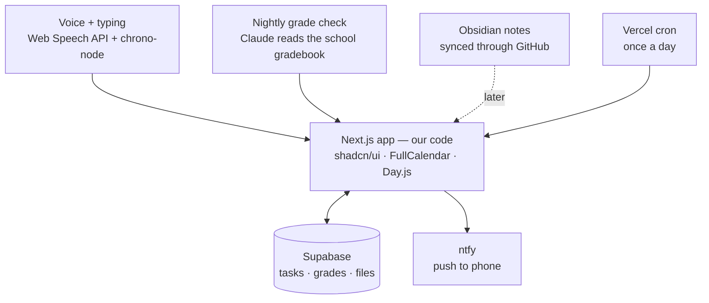

# Architecture sketch

How the prebuilt pieces fit together, and the glue code we write to connect them.
This is a **rough sketch**: real code, but not yet installed or tested.



## What's prebuilt vs. what we write

| Piece | Prebuilt (free) | Our glue code |
|---|---|---|
| Layout, buttons, dark mode | shadcn/ui dashboard template | Pages: Today, Calendar, Grades, Habits |
| Database, login, uploads | Supabase | Table design + a few queries |
| Calendar | FullCalendar | Turn tasks into calendar events |
| Dates | Day.js, chrono-node | "Due Friday" → real date |
| Voice | Browser Web Speech API | Mic button + task parser |
| Reminders | ntfy + Vercel cron | Daily "what's due" job |
| Grades | Claude scheduled task | `/api/grades` endpoint it posts to |

## Folder layout

```
app/
  page.tsx                 Today view
  calendar/page.tsx        Calendar
  grades/page.tsx          Grades + trends
  api/grades/route.ts      Nightly grade sync posts here
  api/reminders/route.ts   Daily cron job
components/
  VoiceTaskButton.tsx      Mic → preview card → save
  TaskCalendar.tsx         FullCalendar wrapper
lib/
  supabase.ts              Database client
  parseTask.ts             Sentence → task
supabase/schema.sql        Tables
vercel.json                Cron schedule
```

## 1. Database tables — `supabase/schema.sql`

```sql
create table classes (
  id uuid primary key default gen_random_uuid(),
  name text not null,             -- "Biology"
  aliases text[] default '{}',    -- {"bio"} so voice can match it
  color text default '#3b5bdb'
);

create table tasks (
  id uuid primary key default gen_random_uuid(),
  title text not null,
  class_id uuid references classes(id),
  due_at timestamptz,
  kind text default 'homework',   -- homework | test | project
  priority text default 'normal', -- low | normal | high
  done boolean default false,
  file_path text,                 -- uploaded homework in Supabase Storage
  created_at timestamptz default now()
);

create table grades (
  id uuid primary key default gen_random_uuid(),
  class_id uuid references classes(id),
  percent numeric,
  checked_at timestamptz default now()   -- one row per night = trend history
);

create table habits (
  day date primary key,
  sleep_hours numeric,
  workout_done boolean default false
);
```

## 2. Database client — `lib/supabase.ts`

```ts
import { createClient } from '@supabase/supabase-js';

export const supabase = createClient(
  process.env.NEXT_PUBLIC_SUPABASE_URL!,
  process.env.NEXT_PUBLIC_SUPABASE_ANON_KEY!
);
```

## 3. Sentence → task — `lib/parseTask.ts`

chrono-node finds the date; simple rules handle the rest.

```ts
import * as chrono from 'chrono-node';

type ClassRow = { id: string; name: string; aliases: string[] };

export function parseTask(sentence: string, classes: ClassRow[]) {
  const lower = sentence.toLowerCase();

  // Date: "due Friday", "next Tuesday", "in 3 days"
  const found = chrono.parse(sentence, new Date(), { forwardDate: true })[0];
  const due_at = found?.start.date() ?? null;

  // Class: match name or alias anywhere in the sentence
  const match = classes.find(c =>
    [c.name, ...c.aliases].some(a => lower.includes(a.toLowerCase()))
  );

  // Kind + priority from keywords
  const kind = /\b(test|quiz|exam)\b/.test(lower) ? 'test'
             : /\b(project|presentation)\b/.test(lower) ? 'project'
             : 'homework';
  const priority = /\b(big|important|urgent|huge)\b/.test(lower) ? 'high' : 'normal';

  // Title: the sentence minus the date words and filler
  let title = found ? sentence.replace(found.text, '') : sentence;
  title = title.replace(/\b(due|it's a big one|by)\b/gi, '').replace(/[,\s]+$/, '').trim();

  return { title, class_id: match?.id ?? null, due_at, kind, priority };
}
// "Bio lab report due Friday, it's a big one"
// → { title: "Bio lab report", class: Biology, due: this Friday, kind: homework, priority: high }
```

## 4. Mic button — `components/VoiceTaskButton.tsx`

```tsx
'use client';
import { useState } from 'react';
import { parseTask } from '@/lib/parseTask';
import { supabase } from '@/lib/supabase';

export function VoiceTaskButton({ classes }) {
  const [draft, setDraft] = useState<any>(null);

  function listen() {
    const SR = (window as any).SpeechRecognition || (window as any).webkitSpeechRecognition;
    if (!SR) return alert('Voice input works in Chrome, Edge, or Safari.');
    const rec = new SR();
    rec.lang = 'en-US';
    rec.onresult = (e: any) => setDraft(parseTask(e.results[0][0].transcript, classes));
    rec.start();
  }

  async function save() {
    await supabase.from('tasks').insert(draft);
    setDraft(null);
  }

  return draft ? (
    <PreviewCard task={draft} onChange={setDraft} onSave={save} onCancel={() => setDraft(null)} />
  ) : (
    <button onClick={listen}>🎤 Add task by voice</button>
  );
}
```

## 5. Calendar — `components/TaskCalendar.tsx`

FullCalendar does the drawing; we just map tasks to events. Dragging a task to a new day updates its due date.

```tsx
'use client';
import FullCalendar from '@fullcalendar/react';
import dayGridPlugin from '@fullcalendar/daygrid';
import interactionPlugin from '@fullcalendar/interaction';
import { supabase } from '@/lib/supabase';

export function TaskCalendar({ tasks, classes }) {
  const colorOf = (id: string) => classes.find(c => c.id === id)?.color;

  return (
    <FullCalendar
      plugins={[dayGridPlugin, interactionPlugin]}
      initialView="dayGridMonth"
      editable
      events={tasks.map(t => ({
        id: t.id, title: t.title, start: t.due_at, color: colorOf(t.class_id),
      }))}
      eventDrop={async ({ event }) => {
        await supabase.from('tasks').update({ due_at: event.start }).eq('id', event.id);
      }}
    />
  );
}
```

## 6. Daily reminders — `app/api/reminders/route.ts` + `vercel.json`

Vercel runs this once a day for free; it posts a summary to ntfy, which pushes it to your phone.

```ts
import dayjs from 'dayjs';
import { supabase } from '@/lib/supabase';

export async function GET() {
  const tomorrow = dayjs().add(1, 'day').endOf('day').toISOString();
  const { data: due } = await supabase
    .from('tasks').select('title').eq('done', false).lte('due_at', tomorrow);

  if (due?.length) {
    await fetch(`https://ntfy.sh/${process.env.NTFY_TOPIC}`, {
      method: 'POST',
      headers: { Title: `${due.length} due by tomorrow`, Tags: 'books' },
      body: due.map(t => `• ${t.title}`).join('\n'),
    });
  }
  return Response.json({ sent: due?.length ?? 0 });
}
```

```json
{ "crons": [{ "path": "/api/reminders", "schedule": "0 14 * * *" }] }
```
(14:00 UTC = 7 AM Arizona time.)

## 7. Nightly grades — `app/api/grades/route.ts`

The Claude scheduled task reads the school gradebook each night and posts what it found here. A shared secret keeps anyone else from posting fake grades.

```ts
import { supabase } from '@/lib/supabase';

export async function POST(req: Request) {
  if (req.headers.get('x-sync-secret') !== process.env.GRADE_SYNC_SECRET) {
    return new Response('Unauthorized', { status: 401 });
  }
  const { grades } = await req.json(); // [{ className: "Biology", percent: 87.5 }, ...]

  const { data: classes } = await supabase.from('classes').select('id, name');
  const rows = grades
    .map((g: any) => ({
      class_id: classes?.find(c => c.name === g.className)?.id,
      percent: g.percent,
    }))
    .filter((r: any) => r.class_id);

  await supabase.from('grades').insert(rows);
  return Response.json({ saved: rows.length });
}
```

## Secrets (kept in Vercel settings, never in the repo)

```
NEXT_PUBLIC_SUPABASE_URL=...
NEXT_PUBLIC_SUPABASE_ANON_KEY=...
NTFY_TOPIC=some-long-random-name     # anyone who knows the topic can read it
GRADE_SYNC_SECRET=another-long-random-string
```

## Build order

1. Template + Supabase tables + Today view (add and check off tasks by typing)
2. Calendar
3. Voice entry
4. Daily reminders
5. Nightly grade sync + Grades page
6. Habits + heat map
7. Obsidian notes (stretch goal)
